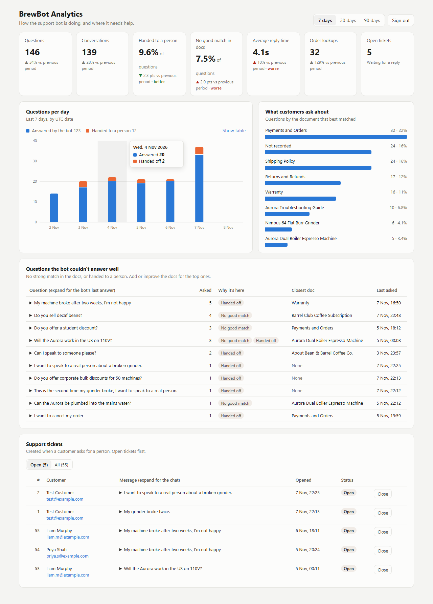

# BrewBot: a RAG support chatbot

BrewBot is a customer-support chatbot for **Bean & Barrel Coffee Co.**, a fictional online shop that sells espresso machines and grinders. It answers **only from the shop's own documents**, cites a source for each answer, and when the answer isn't in the documents it says so instead of guessing.

**Live demo:** https://br-d122a88361a24b8e94f91876dc5ce75e.ecs.ap-southeast-2.on.aws (AWS ECS Fargate, Sydney). Open the chat bubble at the bottom right. Try *"My Aurora shows E03"* or *"Where is order BB-104233? My email is alex@example.com"*.

> Status: **Milestones 1–4c**: streaming `/chat` API with citations, an embeddable chat widget, order lookups, human handoff, an automated eval scoring 36/37, an analytics dashboard, and deployment on AWS (ECS Fargate, defined with AWS CDK) and Render. CI/CD is next (see the [roadmap](#roadmap)).

## Architecture

```
data/docs/*.md ──► ingest script ──► chunk by heading ──► embeddings ──────► Postgres + pgvector
                                                                                      │
visitor ──► POST /chat (SSE) ──► embed question ──► top-k similarity search ◄──────────┘
                                      │
                                      ▼
                      LLM (Gemini / Claude) with numbered sources ──► streamed answer + [n] citations
                                      │
                                      ▼
                              chat_logs table (analytics)
```

| Piece | Choice | Why |
|---|---|---|
| LLM | Pluggable: Gemini 3.5 Flash-Lite (free tier), Claude Sonnet 5.5 via the Claude API, or Claude on Amazon Bedrock | No vendor lock-in; models can be compared on the same eval set. Bedrock keeps data in the client's AWS account |
| Embeddings | Pluggable: Gemini Embedding 2 or Amazon Titan Text Embeddings V2, 1024 dims, normalised | Each chunk records which model embedded it, so vectors from different models are never mixed |
| Vector store | Postgres + pgvector (HNSW, cosine) | One database for vectors, logs and tickets; no extra managed service to pay for |
| API | Node.js, TypeScript, Express 5, Zod | Typed end to end; types shared with the widget via `packages/shared` |
| Streaming | Server-sent events | Simple, works through most proxies, easy to consume from the widget |

### Design decisions
- **Chunk by markdown heading.** Each chunk covers one topic (for example "Error E03"), so retrieval brings back focused context. The document title is added to the start of every chunk so the embedding knows which product or policy the chunk belongs to.
- **Retrieval uses the last two user messages.** This lets a follow-up like "and for the grinder?" still retrieve the right documents.
- **Low-confidence flag.** If the best match falls below `LOW_CONFIDENCE_THRESHOLD`, the model is told the answer probably isn't in the documents, and the flag is logged. These logs feed the "unanswered questions" report.
- **Provider abstraction.** `llm.ts` and `embeddings.ts` hide each vendor behind one function, so switching is a `.env` change.
- **Refusal handling.** On Bedrock, refused requests are retried on a fallback model through the SDK's `betaRefusalFallbackMiddleware`. On the Claude API, the server-side `fallbacks: "default"` parameter does the same job. If every model refuses, the visitor is offered a human.
- **Stateless API.** The client sends the conversation history, so the API can scale horizontally.

## Project layout

```
apps/api            Express API: ingestion, retrieval, /chat; also serves the widget and demo page
  db/schema.sql     Tables (chunks with pgvector, chat_logs, tickets, orders), applied on startup
  src/scripts/      ingest, seed-demo, smoke
apps/widget         Embeddable React chat widget, built to a single brewbot.js
apps/dashboard      Analytics dashboard (React), served by the API at /admin
packages/shared     Types shared by the API, widget and dashboard
data/docs           The fictional shop's knowledge base (10 markdown docs)
infra               AWS CDK app: deploys the container to ECS Express Mode (see infra/README.md)
Dockerfile          One image for the API, widget and dashboard
render.yaml         Render Blueprint for the free-tier deployment
requests.http       Sample requests (VS Code REST Client)
```

## Running locally

Prerequisites: Node 22+, Docker, and a key for at least one provider. The cheapest is a free Gemini API key from [Google AI Studio](https://aistudio.google.com), which covers both chat and embeddings.

```bash
npm install
cp .env.example .env        # then set GEMINI_API_KEY (or pick other providers, see comments in the file)
npm run smoke               # checks the keys and model access
npm run db:up               # Postgres + pgvector on :5433, schema applied automatically
npm run ingest              # chunk + embed data/docs
npm run dev                 # API on http://localhost:3001
```

Try it:

```bash
curl -N http://localhost:3001/chat \
  -H "Content-Type: application/json" \
  -d '{"sessionId":"demo","messages":[{"role":"user","content":"My Aurora is showing E03, what do I do?"}]}'
```

The response is a stream of events:

```
data: {"type":"sources","sources":[{"id":1,"title":"Aurora Troubleshooting Guide","section":"Error E03: temperature sensor fault",...}],"lowConfidence":false}
data: {"type":"delta","text":"E03 means the brew boiler temperature sensor..."}
data: {"type":"done","stopReason":"end_turn","servedBy":"anthropic.claude-sonnet-5-5","usage":{...}}
```

## Tools and human handoff

The model can call two tools, defined once in `apps/api/src/tools.ts` and adapted to each provider:

| Tool | What it does | Safeguards |
|---|---|---|
| `get_order_status` | Looks up an order (mock `orders` table standing in for a Shopify or WooCommerce API) | Needs **both** order number and email; the reply is the same whether the number or the email was wrong, so it can't be used to find out which orders exist; arguments validated with Zod before running |
| `escalate_to_human` | Shows the visitor a contact form | Backed up by a check in code: if the visitor clearly asks for a person, the form is offered even when the model forgets to call the tool |

Submitting the form calls `POST /handoff`, which creates a row in `tickets` with the conversation transcript taken from the server's own `chat_logs` (not from the browser, so it can't be forged), and optionally posts to a Slack-compatible `HANDOFF_WEBHOOK_URL`. The form is also offered when the model refuses, or when the AI provider is rate-limited or down, so the visitor never hits a dead end.

**Guardrails:** per-IP rate limits (`CHAT_RATE_LIMIT_PER_MINUTE`, 5 handoffs an hour), tool loop capped at 4 rounds, tool results and sources treated as data rather than instructions, input length limits, and the database schema is applied automatically on startup (`db/schema.sql` is idempotent).

## Evaluation

`npm run eval` runs 37 test cases through the same pipeline as `POST /chat` and scores every answer automatically. All checks are deterministic (regex, tool calls, events), so a run costs only the chatbot's own model calls and the same answer always gets the same verdict.

| Category | Cases | What is checked |
|---|---|---|
| FAQ, policy, troubleshooting, follow-up | 24 | Key facts present (e.g. "15%" restocking fee), the right document retrieved, and that document cited |
| Orders and privacy | 5 | Right tool called; asks for missing details; **no data about other customers' orders leaks** with a wrong email or an "I'm the admin" request |
| Handoff and unanswerable | 6 | Contact form offered for complaints, cancellations and questions the docs can't answer; no invented prices or discounts |
| Off-topic and prompt injection | 2 | Declines, and doesn't reveal the system prompt |
| **Every case** | 37 | If the answer claims a handoff ("I've opened a form…"), one actually happened |

**Latest results** (Gemini 3.5 Flash-Lite):

| Metric | Result |
|---|---|
| Cases passed | **36/37 (97%)** |
| Retrieval hit@5 | 24/24 (100%) |
| Answer cites the right document | 24/24 (100%) |
| Average latency | ~4s |

The one failure: asked about an order without an email, the model sometimes calls `get_order_status` anyway instead of asking first. The tool's input validation rejects the call, so nothing leaks, but the model broke its instructions, so the case stays failed rather than the check being loosened. Scores vary by a case or two between runs, since model output isn't deterministic.

**Bugs the eval found, all fixed:**
- The model said "I've opened a contact form" without calling the tool, so no form appeared. Fixed with a backstop in code, plus a check on every case.
- An intermittent empty response from the model produced a blank chat bubble. Now retried once, then answered with a fallback message and the contact form.
- An overly narrow check marked a correct answer as wrong. Widened the check after reading the answer.

```bash
npm run eval                            # all cases
npm run eval -- --category privacy      # one category
npm run eval -- --ids e03,klarna        # specific cases
```
Full answers and per-check results are saved to `apps/api/eval-results/`.

## The chat widget

Any website can add the bot with one tag:

```html
<script src="https://your-api.example.com/brewbot.js"
        data-title="Bean & Barrel Help" data-color="#7a4b2a" defer></script>
```

- **One file:** React and the CSS are bundled into `brewbot.js` (about 72 KB gzipped).
- **Shadow DOM:** the host site's CSS can't restyle the widget, and the widget's CSS can't leak into the site, so it works on any WordPress or Shopify theme.
- **Configured by `data-*` attributes:** `data-title`, `data-color`, `data-greeting`, and `data-api-url` (defaults to wherever the script was loaded from).
- **Streaming answers** with citation chips and a list of the sources each answer used.
- **Mobile and accessibility:** full screen on phones, dark mode, keyboard support (Enter to send, Escape to close), screen-reader labels, reduced motion.
- The conversation survives page navigation within a tab (sessionStorage); a visitor id in localStorage groups their chats in the logs.

`npm start` builds the widget and serves a demo shop page at http://localhost:3001 with the bot embedded. For widget development, run `npm run dev:widget` (rebuilds on save) alongside `npm run dev`.

## Analytics dashboard



A dashboard for the shop owner at `/admin`, built from the `chat_logs` and `tickets` tables:

- **Headline numbers** compared with the previous period: questions, conversations, handoff rate, "no good match" rate, average reply time, order lookups and open tickets.
- **Questions per day**, answered by the bot vs handed to a person, with a tooltip, keyboard navigation and a table view.
- **What customers ask about**, ranked by the document that best matched each question.
- **Questions the bot couldn't answer well**, grouped by question and counted. This is the to-do list for improving the docs.
- **Support tickets** with the chat transcript, a reply-by-email link, and close/reopen.

Access needs a bearer token: set `ADMIN_TOKEN` in `.env` (at least 16 characters, e.g. `openssl rand -hex 24`) and sign in with it. The admin API is same-origin only and rate limited, and it compares the token in constant time. Without `ADMIN_TOKEN` the dashboard is turned off.

For a demo with realistic data, `npm run seed:demo` adds 60 days of synthetic conversations and tickets. They are tagged, so `npm run seed:demo -- --clear` removes only those. `npm start` builds the widget and the dashboard; for dashboard development, run `npm run dev:dashboard` alongside `npm run dev`.

## Deployment

The app ships as **one Docker image** ([Dockerfile](Dockerfile)): a multi-stage build that bundles the API, the widget and the dashboard. It runs as a non-root user and executes the TypeScript directly with Node's type stripping. All configuration comes from environment variables, so no secrets are baked into the image.

```
                        ┌──────────── AWS, ap-southeast-2 (Sydney) ────────────┐
visitor ──HTTPS──►      │  Application Load Balancer (ECS-managed, ACM cert)   │
                        │              │                                       │
                        │              ▼                                       │
                        │  ECS Express Mode service on Fargate (1–2 tasks)     │
                        │  secrets from SSM Parameter Store (SecureString)     │
                        └──────────────┬───────────────────────────────────────┘
                                       ├──► Neon Postgres + pgvector, same Region
                                       └──► Gemini API
```

| Target | How | Notes |
|---|---|---|
| **AWS** ([live](https://br-d122a88361a24b8e94f91876dc5ce75e.ecs.ap-southeast-2.on.aws)) | **ECS Express Mode** on Fargate, defined in **AWS CDK** (TypeScript) in [infra/](infra/) | HTTPS load balancer, auto scaling, CloudWatch logs and deployment alarms managed by ECS. Least-privilege IAM roles. `cdk deploy` builds and pushes the image to ECR; `cdk destroy` removes everything. See [infra/README.md](infra/README.md). |
| **Render** (free tier) | [render.yaml](render.yaml) Blueprint, auto-deploys on push | Free instance sleeps when idle; `/ping` is a database-free health check so pings don't keep the database awake. |
| **Database** | [Neon](https://neon.tech) serverless Postgres with pgvector | One database per deployment, in the same Region as the app, because each chat runs several queries. Scales to zero when idle. |

Things that only showed up in production:
- **Rate limits behind proxies.** Per-visitor limits key on the client IP, which the app reads from `X-Forwarded-For`. `TRUST_PROXY_HOPS` must match the number of proxies in front of the app (1 for the AWS load balancer). Too few, and visitors share limits; too many, and anyone can fake their IP.
- **First deploy on a new AWS account** failed because ECS's service-linked roles didn't exist yet; they are created on first use.
- **The low-confidence threshold is model-specific.** It now defaults per embedding provider (Gemini 0.6, Titan 0.35), so a deployment can't silently use the wrong one.

## Roadmap

- [x] **M1**: knowledge base, ingestion, RAG `/chat` with citations and streaming, chat logging
- [x] **M2**: embeddable React widget (`<script>` tag) and demo page
- [x] **M3**: human handoff (contact form, tickets, webhook), `get_order_status` tool, guardrails
- [x] **M4a**: eval suite (37 cases, deterministic scoring)
- [x] **M4b**: analytics dashboard (trends, topics, weak answers, tickets)
- [x] **M4c**: public deployment (Docker; AWS ECS Express Mode via CDK; Render; Neon Postgres)
- [ ] **M4d**: CI/CD (typecheck and evals on every push)
